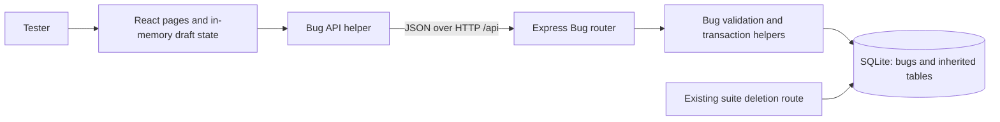

# ADR-001: Report and track a defect from a failed execution

| Item | Value |
| --- | --- |
| Status | EM's proposed decision; MR review and the confirmations below are pending |
| Owner / reviewer | EM (`RS77713`) / MR (`makss-rivero`) |
| Branch | `codex/em-h1-architecture` |
| Issue | [#8: Decide Bug reporting architecture](https://github.com/RS77713/Software-Engineering2---Group-Project---Managment-Tool/issues/8) |
| Date | 2026-11-14, Europe/Riga |
| Inherited baseline | `part1-baseline` -> `bc304f1d954cb1e55d5ec7cdd06e49bba455613e` |
| Inspected main | `835562e8c2afef0d9f7516ccc520ecfc24047a8a`, after PR #7 |

This is a design decision for future implementation. The baseline has no Bug
table, HTTP routes or client pages. The API and client contracts define the
observable behaviour; this document selects an architecture and identifies
the integration work and acceptance evidence needed to deliver it.

## Need and bounded increment

A tester who finds a failed execution needs to record a defect with reproduction
details, return to that exact execution, and track the defect to closure.
Today the tester can save result notes but cannot create or follow a Bug record.

The proposed H2 increment is one bug-reporting workflow: select a failed result,
explicitly submit a report, inspect the saved bug, find existing reports, and
update its details/status. Supporting list/detail reads are also needed when a
creation response is lost. Implement the four endpoints in the
[Bug API contract](bug-api-contract.md), including its standalone-create API
semantics; the primary client entry point remains a failed execution.

Include the additive database change and suite-deletion retention boundary in
this increment. Exclude bug deletion, assignments, comments, attachments,
notifications, authentication, Reports, Settings and Flaky Tests. Closing a bug
retains its source. Source uniqueness and exactly-once creation are not promised.

## Existing structure and constraints

- [React routes](../../client/src/App.jsx) select pages; page components use
  feature-specific API helpers and local state.
- [Vite](../../client/vite.config.js) proxies `/api` to Express in development.
  [Express](../../server/app.js) serves the built client in production and
  mounts the existing feature routers.
- [SQLite initialization](../../server/db.js) uses one `better-sqlite3`
  connection, WAL and foreign-key enforcement. Existing routers perform
  parameterized queries and use transactions for multi-step operations.
- [Run detail](../../server/routes/test-runs.js) returns distinct result IDs,
  run IDs and case IDs. Outcomes and notes remain editable. Run membership
  does not freeze case text or result notes.
- [Suite deletion](../../server/routes/suites.js) deletes the suite; foreign
  keys cascade through runs to results. A retained source introduces a real
  change at this existing boundary.
- Node 24 is required. The inherited project has no authentication/role model
  and allows CORS. Baseline startup also seeds synthetic data. These are
  constraints, not capabilities added by this decision.

## Options and decision

| Option | Benefit | Cost / reason for selection or rejection |
| --- | --- | --- |
| Extend the existing React + Express + SQLite application | Reuses delivery, transactions, result IDs and current test tools | Selected. One four-person team can review a single integration boundary and keep existing data in one database. |
| Separate Bug service and database | Independent deployment and scaling | Rejected for this need: cross-service source retention, recovery and consistency add work without an identified deployment requirement. |
| Store reports only in the browser or result notes | Small initial UI change | Rejected: browser-local storage cannot provide shared durable reports; notes lack separate bug identity, lifecycle and source-retention enforcement. |

Use a modular monolith: one Express application and SQLite database, with a
feature router and focused Bug domain/persistence helpers. The browser owns
presentation and drafts; the server owns validation, lifecycle and relationship
rules. Database constraints provide a second check on lengths/enums and retain
referenced results. Avoid a general framework or a refactor of unrelated routes.

The Bug boxes describe proposed components. Existing application components
were inspected at the main SHA above; the diagram is not evidence of implementation.

## Responsibilities and client routes

| Area | Proposed responsibility and location |
| --- | --- |
| Failed-result entry | Extend `TestRunDetailPage.jsx` with Create Bug only for an eligible selected result. Opening a form or marking a result failed sends no Bug POST. |
| Creation form | A focused component captures title, severity, Steps, Expected and Actual; assembles the API description and displays accessible validation and outcome states. |
| Draft ownership | A small React provider above the routes retains the draft and original submitted payload/source IDs/time across candidate navigation and return. Key drafts by source result; keep the original attempted payload distinct from later edits. |
| Bug list | Proposed `/bugs` route; search/filter/sort/paginate using documented API parameters and show loading, empty and failed-read states. |
| Bug detail | Proposed `/bugs/:id` route; show the saved resource, retained source link and current source state. Edit details/status using the complete PUT payload. Return to a retained draft after candidate inspection. |
| Source navigation | Link to the existing `/test-runs/:runId` with a `resultId` query parameter; extend run detail to select/focus that exact result. The query parameter is a proposed client convention. |
| API helper | Proposed `client/src/api/bugs.js`; validate HTTP status and response envelope, classify rejected versus uncertain creation, and never automatically retry POST. |
| Server | Proposed `server/routes/bugs.js` plus focused domain/persistence helpers; mount under `/api/bugs`, map snake_case storage to contract JSON, and return contract errors. |

Draft preservation covers navigation during the current browser session.
Persistence across reload, tab closure or a browser crash is outside this first
decision. Explicit discard or confirmed creation clears the draft. Returning
from a candidate does not clear it. Do not add browser persistent storage for
potentially sensitive reproduction text in this increment.

These routes close the client contract's navigation question as an EM proposal;
MK must confirm them before implementation. Bug detail must omit both source
fields from PUT, retain the derived case ID for a source-linked bug, and display
the server's actual error without inferring a field from its wording. The server
validates transitions against the current stored status; valid concurrent edits
remain last-write-wins, as the API specifies.

## Behaviour, state and retry decisions

Adopt the exact fields, enums, Unicode code-point limits, envelope and failure
codes from the [API contract](bug-api-contract.md). The
[client contract](client-behaviour.md) supplies deterministic reproduction-text
mapping and 17 Given/When/Then checks. This ADR does not redefine those limits.

- Lifecycle: `open -> in-progress`; `in-progress -> open | resolved`;
  `resolved -> in-progress | closed`; `closed -> open`. Keeping the current
  status during an edit is valid. Invalid transitions leave every field and
  timestamp unchanged.
- A non-null `sourceResultId` is create-only, must identify a failed result at
  insertion, and derives the immutable case/run identity. Validate source and
  insert in the same write transaction. Later outcome/notes edits remain valid
  and do not rewrite the Bug description or source. Several bugs may share a source.
- UI states are editing, submitting, rejected, uncertain, reconciling and
  confirmed. Guard button and keyboard submissions while a POST is pending.
  A valid `201` confirms creation. A valid contract rejection retains the form
  for correction. Timeout, invalid response, connection loss or `5xx` retains
  uncertainty rather than enabling an immediate repeat POST.
- For uncertainty, use fresh paginated list/detail GETs, source-filtered when
  applicable. Preserve the original payload while inspecting candidates; title
  and creation time alone do not identify the original request. Failed reads
  keep uncertainty. Multiple candidates require inspection. After successful
  refreshed checks with no identified match, only the user may explicitly
  resubmit, with the documented remaining duplicate risk. No automatic POST retry.

## Storage, retention and earlier data

Use the table, indexes and foreign keys in API section 7. Store one source-result
reference and derive the run ID through a join. Keep foreign keys enabled;
`ON DELETE RESTRICT` retains the source even after a bug is closed. Standalone
test-case links use `ON DELETE SET NULL` when existing case-deletion rules permit
deletion. These automatic unlinks do not change the Bug API timestamp.

Select a small versioned additive migration rather than destructive reseeding.
Proposed implementation: `server/migrations/001-bugs.sql` and a runner invoked
from database initialization after inherited tables exist and before seeding or
serving requests. The inspected baseline does not use `PRAGMA user_version`;
use version 0 for inherited data and 1 for this migration. Apply table/index
creation and the version change in one transaction, make a second startup a
no-op, and fail startup on an unsupported newer schema. Migration failure must
leave the prior schema/data intact. Do not drop tables, renumber existing IDs,
or delete/repopulate existing data. Verify on a consistent isolated baseline
database copy as well as a fresh database.

Suite deletion must catch the specific retained-source constraint and return
`409` with the existing failure envelope. The entire delete must be atomic:
suite, membership, runs, results and bugs remain unchanged after rejection.
Unreferenced suites retain their earlier deletion behaviour. Do not convert
unrelated database failures into `409`. A precheck can improve the message but
cannot replace foreign-key enforcement. Direct SQL deletion of a retained run
or result must also fail. No direct HTTP run/result deletion endpoint is added.

## Verification expectations and traceability

These are acceptance expectations to implement and independently verify in H2/H3,
not results of this documentation change. API section 8 and client section 12
remain the detailed scenario sources.

| ID | Observable expectation | Intended verification boundary |
| --- | --- | --- |
| R1 | Opening Create Bug sends no POST; valid explicit submission returns a saved bug with the selected result's derived case/run IDs. | Client interaction plus real HTTP/SQLite creation and reopen checks. |
| R2 | Invalid severity, blank reproduction input, title at 200/201 and assembled description at 5,000/5,001 code points have the documented outcomes; invalid writes change nothing. | Client boundary tests and independent server tests, including non-BMP text. |
| R3 | A source deleted or changed to non-failed before validation produces 404/409 and no Bug insertion; later source edits retain the original reference. | Real source/Bug HTTP operations against isolated SQLite. |
| R4 | Double click or keyboard repeat sends one POST; losing a response after commit sends no automatic second POST; paginated reconciliation can find the saved bug while preserving the draft. | Controlled client transport failure after a real commit; include later-page, multiple-candidate and failed-read cases. |
| R5 | Allowed transitions persist; forbidden transitions and invalid complete PUT payloads leave fields/timestamps unchanged. Bug edits do not change existing run totals or test statuses. | Requirement-derived API/state tests with independent before/after reads. |
| R6 | Suite deletion with a retained source returns 409 with no partial deletion, including after Bug closure; an unreferenced suite still deletes. | Real suite HTTP route and database relationship checks, plus direct SQL restriction checks. |
| R7 | A baseline database upgrades without changed inherited IDs/rows; second startup is safe; failed/unsupported migrations stop startup safely. | Isolated earlier-data fixture, before/after comparison, reopen and fault checks. |
| R8 | Labels, focus/error association, loading/empty/failure states and success/source navigation work for keyboard users. | Client tests plus a recorded browser inspection of the implemented increment. |

Keep the current regression checks: `npm run lint`, `npm test`, `npm run build`.
The recorded inherited counts are 40 client and 58 server tests; future totals
must come from the actual run, not a fixed target. Existing client tests mock
API helpers and server tests use real HTTP/SQLite; neither alone demonstrates
the full browser-to-server workflow. BK's independent check must exercise that
real boundary with synthetic data and save tested SHA, environment, results
and failures. H3 sensitivity work should show that a relevant deliberate fault
causes a requirement-derived check to fail; it has not been performed in H1.

## Team responsibilities and working rules

| Member | Recorded role | Cross-review responsibility |
| --- | --- | --- |
| EM / `RS77713` | Architecture, integration and delivery coordination | Review MR's API/domain work; MR reviews EM's decision. |
| MK / `DizzyWaters` | Frontend/client behaviour and implementation | Review BK's verification; BK reviews MK's client work. |
| MR / `makss-rivero` | Backend/domain and persistence | Review EM's decision; EM reviews MR's implementation. |
| BK / `bkuvshinnikov` | Testing, independent verification and delivery evidence | Review MK's client work; MK reviews BK's evidence. |

These roles and review pairs were recorded during team coordination. They do not
prove completion of future checks. AI occupies no team role. The existing team
chat coordinates work; GitHub issues/PRs record substantive decisions, findings,
revisions and approvals. Each member uses their own account and reviews the
actual proposed revision. Approval counts and branch protection depend on the
repository's configured rules; this document does not claim three approvals
are enforced. EM integrates after the assigned review and passing checks.

Follow the existing [baseline data policy](../baseline.md#data-and-secrets):
synthetic data only, no committed secrets, `.env`, databases or private chat
captures. Keep raw local evidence in the ignored evidence archive; publish
selected redacted evidence necessary for review. Check custom `DB_PATH` outputs
before staging, since the inherited ignore rules name the default database.
Use bound SQL parameters and allowlisted sort fields, validate server-side and
render descriptions as plain text. The existing unauthenticated API is suitable
only for the agreed isolated demonstration setting until an explicit deployment
trust-boundary decision is made; CORS does not authorize a user.

## Readiness and decision record

Baseline scope/provenance are in [the inherited baseline](../baseline.md).
The earlier working-copy history was unavailable; preserve the transparent import
and permanent annotated tag rather than invent earlier commits.

- [PR #3](https://github.com/RS77713/Software-Engineering2---Group-Project---Managment-Tool/pull/3)
  integrated the API proposal after EM's review.
- [PR #6](https://github.com/RS77713/Software-Engineering2---Group-Project---Managment-Tool/pull/6)
  integrated the [baseline reproduction](baseline-reproduction.md) after MR's
  approval. Historical pending-review wording there is superseded by the PR
  review record; personal/browser checks remain separately pending.
- [PR #7](https://github.com/RS77713/Software-Engineering2---Group-Project---Managment-Tool/pull/7)
  integrated client/API alignment after BK's approval. This is contract review,
  not proof of working Bug pages or confirmation of every API section 9 choice.
- BK's [PR #4](https://github.com/RS77713/Software-Engineering2---Group-Project---Managment-Tool/pull/4)
  is under MK re-review; its evidence is not treated as approved in this ADR.

Readiness actions before claiming H1 agreement or starting the feature:

| Action | Owner / evidence needed |
| --- | --- |
| Review this architecture, scope, versioned migration, transaction and retention decisions | MR: substantive PR review; record requested revisions and the reviewed SHA. |
| Confirm routes, draft lifetime, complete PUT behaviour and lifecycle interface | MK: explicit decision on the PR. Alignment approval alone does not settle these proposals. |
| Confirm acceptance coverage and independent verification approach | BK: comment/review against R1-R8 and the contract scenarios; finish PR #4 re-review with MK. |
| Agree reproducible npm/install-script prerequisites | EM coordinates with BK. Propose Node 24 plus npm 11.19.1 as a candidate because EM/MK recorded successful use; it still needs a clean-install script-policy check on supported environments before becoming the setup standard. |
| Record dependency-advisory remediation or a justified disposition | EM/MR with BK verification; retain dated findings. Different historical warning totals do not establish that issues were fixed. |
| Complete missing personal/browser baseline inspection | EM: record exactly what was inspected, without substituting automated HTTP output for visual checks. |

These owners are proposed follow-ups, not claims of approvals or completed
repairs. Resolve the design decisions and reproducibility prerequisites before
feature scope grows; release acceptance still requires later dependency and
operational decisions. Rollback/data restoration (H5), post-release maintenance
and retirement (H6) need their own execution evidence and are not satisfied by
this architecture document.

Verification scope for this ADR: Codex assisted repository inspection, design
drafting and documentation checks on EM's behalf. MR's architecture review is
pending. No new Bug endpoint, migration, client page, security repair or feature
test was executed by this documentation change.
